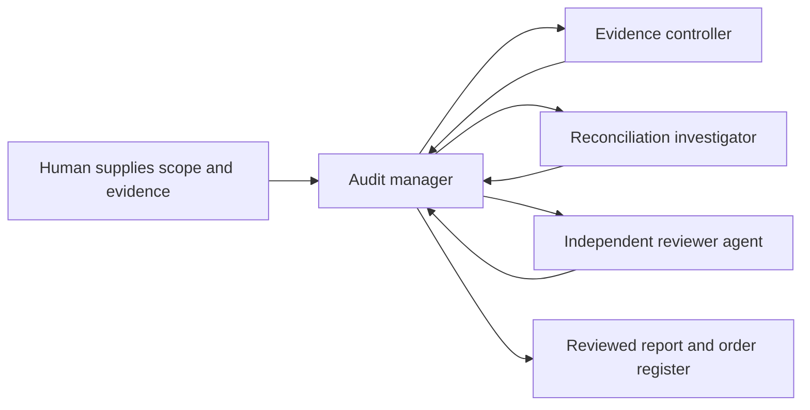

# Audityard

**A supplier-payment audit team coordinated through Switch.**

An audit lead needs to connect three things — what was ordered, what the evidence supports, and what was paid. Audityard divides that work between four Claude Code agents in a shared Mattermost room. The manager assigns tasks through Switch, a separate reviewer checks the sources and calculations, and the human gets a report with a decision for every work order.

Built for the **Best Business Workflow** track of the Switch hackathon. This repository contains the workflow configuration, a fictional audit packet, and the outputs of one completed run.

[Switch template](audityard.template.yaml) · [Run it](docs/reproduce.md) · [Read the report](example-run/final_report.md) · [Demo script](demo/script.md)

## What the demo shows

Meridian Works is a fictional company buying services from suppliers. The task was to review its October 2026 payments against nine supplied company policies, using evidence available through 7 November. The packet contains 184 work orders, 187 evidence extracts, and 188 payment rows. It includes duplicate payments, approval limits, deposit terms, missing records, and conflicting evidence.

One useful comparison is in the [final report](example-run/final_report.md).

| Order | Evidence | Conclusion |
|---|---|---|
| WO-6210 | Treasury confirmed it skipped the required phone check after a supplier changed bank details. | Confirmed control breach. The $3,600 payment is potentially exposed; loss is unproven. |
| WO-1507 | The phone-check record was unavailable. | Unresolved. Missing documentation does not establish that the check was skipped. |

The reviewer also asked the manager to separate recovery items, uncertain exposure, and unpaid obligations in the register. The delivered register includes an `exposure_bucket` column. The [review notes](example-run/review/initial-review.md) and [final comparison](example-run/review/final-comparison.md) show what was checked and what changed.

## Why Switch is part of the workflow

The room is where work is assigned, returned, reviewed, and delivered. Each specialist has its own agent session and working directory. All four can read the shared case files on the same machine.

The manager sends addressed messages through Switch and waits for actual results. The room rules require source references, task and evidence versions, and explicit blockers. Unresolved disagreements go to the human after at most two investigation–review cycles. The recorded run completed two review passes and made presentation corrections without using a full investigation revision cycle.

My contribution is the four-role workflow, shared room rules, handoff protocol, review loop, and benchmark exercise, developed with AI assistance. Switch supplies the room and agent connections; Claude Code runs the agents; Mattermost displays the conversation.

## Results from the recorded run

| Check | Result |
|---|---|
| Order coverage | 184 of 184, with no duplicate register entries |
| Net settled cash | $559,140 after failed attempts, repeated export rows, and returns were handled |
| Challenge cases | 22 of 24 earned full conclusion credit; two earned partial credit |
| Rubric score | 91/100 in a separate AI-assisted answer-key assessment |
| Unsupported-allegation gate | Passed under the supplied rubric |

The score is a rubric assessment of **one synthetic run**. The 160 ordinary orders follow similar patterns and are not 160 independent tests of difficult audit reasoning. The [evaluation](evaluation/README.md) includes the scoring breakdown, deductions, and test limitations. The answer key and hidden evaluator notes are kept local.

The agents received a separate copy of the four input files. No evaluator-file access was found in the recorded agent tool calls, but the evaluator files were accessible under the same Mac account. The run therefore did not meet the evaluator guide's requirement for filesystem isolation.

## Try it

You need Switch Console with a local Mattermost connection, Claude Code installed and signed in, and Python 3 for the two small helper scripts. The recorded run used Switch Console 0.40.1 on macOS.

1. Import [audityard.template.yaml](audityard.template.yaml) in Switch Console. Choose a fresh team prefix and your Mattermost connection. All four agents must run on the same machine.
2. From this repository, run `python3 scripts/prepare_case.py`. It creates a separate case folder containing only the four inputs and an empty output folder, then prints the kickoff message.
3. Paste that message into the new room. Follow the manager's assignments, review replies, and final delivery.

The default team prefix is `audityard`. If you change it during import, pass the same value to `python3 scripts/prepare_case.py --team YOUR_PREFIX`.

The released template passed a fresh import, four-agent creation, and three-specialist handoff check. For setup details and the exact test boundaries, see [reproduction notes](docs/reproduce.md) and [verification](docs/verification.md). To check the published example's cash totals, coverage, and reference ownership, run `python3 scripts/verify_example.py`.

## Repository guide

| Path | Purpose |
|---|---|
| `audityard.template.yaml` | Four agent definitions and the shared room rules |
| `agent-pack/` | The four fictional audit inputs |
| `example-run/` | Original report, register, reconciliation, and both reviewer passes |
| `evaluation/` | Public rubric summary, cash controls, and assessment; exclude these from audit inputs |
| `demo/` | Read-aloud script and recording sequence |
| `scripts/` | Case preparation and deterministic checks of the saved example |

## Current limits

The benchmark uses readable text extracts. It does not test PDF scanning, document authentication, live banking integrations, or real audit assurance. The reviewer is another AI agent. A person still needs to review the findings and decide what action to take.

The completed run exposed four weaknesses in evidence follow-up and uncertainty wording. They are documented in the evaluation, and the original outputs remain unchanged. The released template adds clearer general instructions for these areas; its performance on a new audit has not been scored.

[Switch getting started](https://docs.switchagents.ai/switch-rooms/getting-started) · [Switch source](https://github.com/sandbox-quantum/switch) · [Hackathon](https://www.wemakedevs.org/hackathons/switch)
